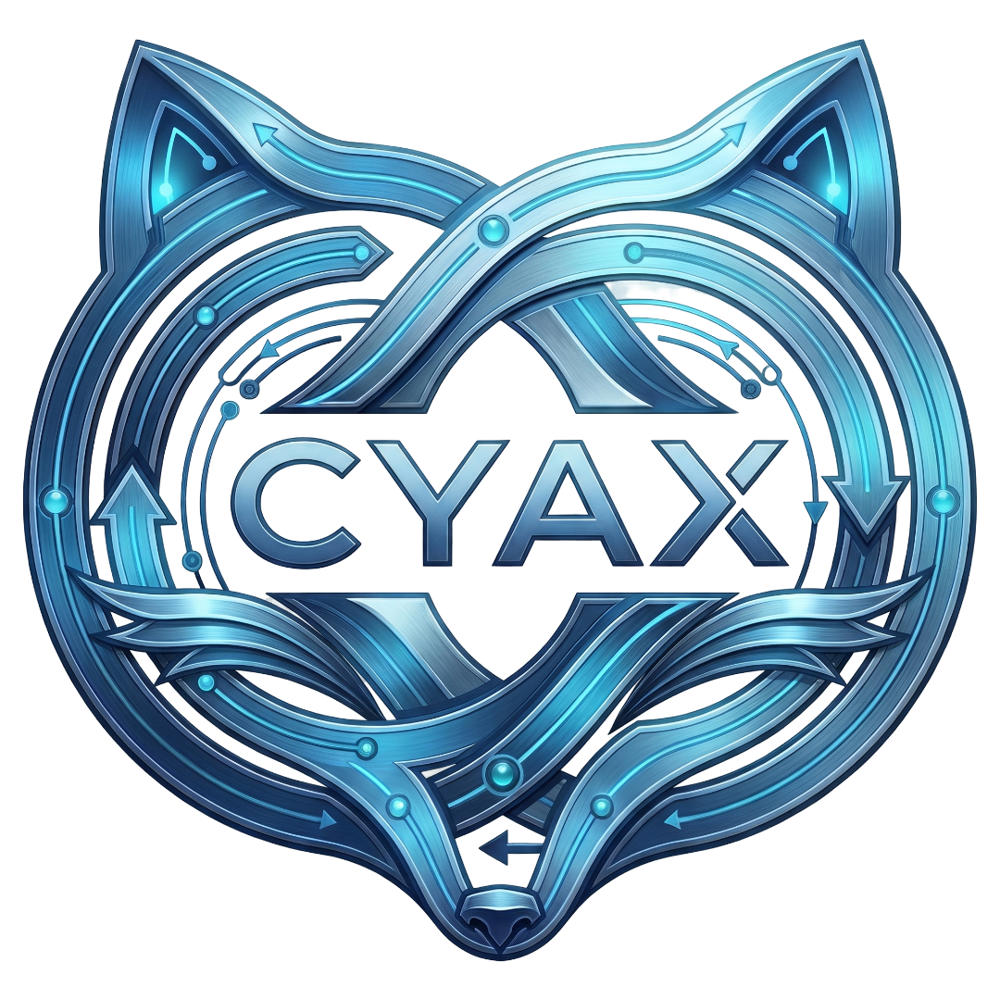

<div align="center">
  
  <h1>Cyax — Continuous-Time Control Systems Simulator & Symbolic Engine</h1>
  <p>
    <strong>Model Block Diagrams. Derive Symbolic Transfer Functions.</strong><br />
    Interactive browser simulator and offline Windows desktop application for continuous-time LTI control systems.
  </p>
  <p>
    <a href="https://cyax.vercel.app/"><strong>Live Web App</strong></a> •
    <a href="https://github.com/ahsmr/Cyax/releases/latest"><strong>Download for Windows (.exe)</strong></a> •
    <a href="#license--third-party-open-source-libraries"><strong>MIT License</strong></a>
  </p>
</div>

---

## Overview

**Cyax** (`v1.0.0`) is a lightweight simulator and symbolic solver for continuous-time linear time-invariant (LTI) control systems. Built to bridge handwritten control theory derivations with step-by-step verification, it runs directly in the browser or as an offline Windows desktop application with mathematical typesetting powered by KaTeX.

---

## Core Engines & Capabilities

- **Interactive Block Diagram Canvas:** Construct multi-loop continuous-time topologies using integrators ($1/s$), gain blocks, summing junctions, and direct feedthrough paths on a drag-and-drop canvas powered by `@xyflow/react`.
- **State-Space Realization $(\mathbf{A}, \mathbf{B}, \mathbf{C}, D)$:** Automatically extracts state-space matrices from block topologies and evaluates **Controllability**, **Observability**, **Minimality**, and **Internal Stability** via adaptive QR / Hessenberg–Givens eigenvalue decomposition.
- **Symbolic Transfer Function $H(s)$ & ODE Derivation:** Computes $\mathbf{C}(s\mathbf{I} - \mathbf{A})^{-1}\mathbf{B} + D$, performs polynomial Euclidean GCD pole-zero cancellation, verifies **Causality** and **BIBO Stability**, and derives the corresponding time-domain differential equation.
- **Bode Frequency Plotter:** Sweeps logarithmic frequencies to render magnitude ($\text{dB}$) and unwrapped phase plots with an animated frequency sweep mode.
- **Nyquist Locus Diagram:** Plots complex frequency trajectories in the Cartesian plane around the $(-1, j0)$ critical stability point.
- **Analytic Impulse Response $h(t)$:** Computes closed-form inverse Laplace transforms into Dirac impulses, real exponentials, and damped harmonic terms via partial-fraction expansion.
- **Standalone Polynomial Sandbox:** Enter raw ascending numerator and denominator polynomial arrays `[c0, c1, c2, ...]` directly to inspect Bode, Nyquist, and $h(t)$ responses without constructing a block diagram.

---

## Tech Stack & Verification

- **Core Engines & UI:** React 18, TypeScript, Vite
- **Block Canvas & Math Rendering:** `@xyflow/react`, KaTeX, Lucide React
- **Desktop Packaging:** Electron (`electron-builder`)
- **Testing & Benchmarking:** Automated Vitest unit and numerical benchmark suites

---

## Project Structure

```text
cyax/
├── Docs/           # LaTeX technical documentation and mathematical specifications
├── src/            # Pure TypeScript symbolic/numerical solvers & React simulator UI
├── electron/       # Electron desktop wrapper configuration
├── website/        # Showcase landing page & online simulator host (Vercel)
├── public/         # Brand assets and application icons
├── package.json    # Dependencies, build scripts, and Electron packaging config
└── vite.config.ts  # Vite bundler configuration
```
--- 

## Local Development

```bash
# Install dependencies
npm install

# Run the simulator in development mode
npm run dev

# Run the automated Vitest verification and benchmark suite
npm test

# Build the offline Windows desktop installer (.exe)
npm run electron:build
```

---

## Author & Contact

**Amir Hossein Saber Moghaddam Ranjbar** — Creator & Lead Developer  
Engineering Student • Leuven, Belgium  
GitHub: [@ahsmr](https://github.com/ahsmr) • Email: [ahsmr.dev@gmail.com](mailto:ahsmr.dev@gmail.com)

---

## License & Third-Party Open-Source Libraries

Released under the **MIT License** — © 2026 Amir Hossein Saber Moghaddam Ranjbar (`@ahsmr`).  
*Independent open-source educational project. Not affiliated with, endorsed by, or connected to any other company, university, or entity bearing a similar name.*

Cyax is built using open-source software licensed under the MIT License:
- **[@xyflow/react](https://reactflow.dev/)** — Interactive node-based block canvas
- **[Electron](https://www.electronjs.org/)** — Cross-platform desktop packaging
- **[KaTeX](https://katex.org/)** — Fast mathematical typesetting
- **[Lucide React](https://lucide.dev/)** — UI iconography